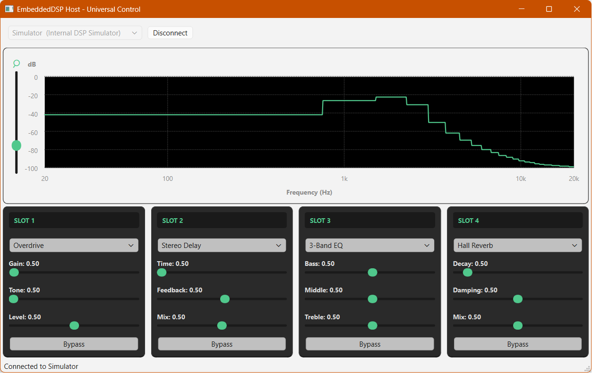

# Real-Time Embedded Audio Multi-FX Processor & Spectrum Visualizer

> Bare-metal C++20 audio DSP on **STM32F411**, paired with a **Qt 6** desktop host over USB CDC for control, streaming, and real-time spectral analysis.



---

## Project Overview

End-to-end guitar multi-FX system: low-latency processing on a memory-constrained MCU, a **static (non-virtual) effect pipeline** on the audio path, and a **shared binary USB protocol** compiled into both firmware and host.

| Layer | Role |
|--------|------|
| **Firmware** | I2S capture/playback, DMA double-buffering, `DynamicAudioPipeline` (up to 4 slots), USB framing |
| **Shared** | `ControlPacket`, `AudioFramePacket`, CRC, constants — single contract for PC and MCU |
| **Host** | Connection UI, effect rack, spectrum view; **Serial** or **Demo** backend without hardware |

---

## Key Features

### Firmware (STM32F411RE)

- **I2S audio** with half/complete DMA callbacks and double buffering.
- **C++20 pipeline:** `std::variant` + `std::visit` and `AudioEffectConcept` — no vtables on the hot path.
- **Effects:** e.g. delay (SRAM-friendly mono `int16_t` + interpolation), overdrive; empty slot placeholder.
- **USB Virtual COM:** 9-byte control packets (host → device) and fixed-size audio frames with **CRC-16** (device → host).
- **State model:** slot effect type, bypass, parameters; optional flash persistence structure (`PipelineSettings`).

### Host (Qt 6, C++20)

- **`AppController`** — UI-facing `int` API (`setParameter`, `setEffectType`, `setBypass`); `Protocol::ControlPacket` stays in Core/Backend.
- **Polymorphic `IDeviceBackend`:** `SerialBackend` (real hardware) or **`DemoBackend`** (synthetic audio + manifest) when `ENABLE_SIMULATOR` is ON.
- **`AudioFrameWorker`** on a dedicated **`QThread`** — FFT (`FftProcessor`) off the GUI thread; spectrum fed to custom plot widgets.
- **Modular UI:** `UI/Spectrum/*`, `UI/Effects/*` (rack/items), global **`style.qss`**, stable `#objectName` IDs in `UI/UiObjectNames.h`.

### Tests (PC)

- **DSP & Firmware Logic:** `dsp_unit_tests` verify audio algorithms (Overdrive, Delay clipping) and the `ControlParser` byte-stream logic in isolation from the hardware.
- **Host Application:** `host_unit_tests` focus on system reliability:
  - **Manifest Parsing:** Robust interpretation of hardware-provided capability strings.
  - **Async Controller Logic:** Uses **Google Mock** and `std::promise` to verify multi-threaded communication between the GUI and hardware backends.
  - **Spectral Analysis:** Validation of the `FftProcessor` using reference sine waves to ensure accurate frequency detection.

---

## Testing Strategy

Since embedded development makes debugging on hardware slow, this project emphasizes **PC-side verification**:

1. **Algorithm Validation:** DSP effects are header-only and C++20 compliant, allowing them to be compiled into native unit tests. We test clipping math and buffer handling without flashing the MCU.
2. **Hardware Mocking:** The `AppController` is tested against a `MockDeviceBackend`. This allows us to simulate hardware errors or sudden disconnections and verify that the UI responds correctly.
3. **Protocol Integrity:** Shared headers ensure that the bit-layout of packets is identical on both sides, with CRC-16 checks verified in unit tests.

## Architecture

```text
┌─────────────────────────────────────────────────────────────────┐
│  Qt Host (GUI thread)                                           │
│  MainWindow → EffectRack / SpectrumPanel → AppController        │
└────────────────────────────┬────────────────────────────────────┘
                             │ signals / int slot API
┌────────────────────────────▼────────────────────────────────────┐
│  AppController + IDeviceBackend (worker QThread)                │
│  SerialBackend │ DemoBackend  →  ControlPacket TX / RX           │
│  audioFrameReady ──► AudioFrameWorker ──► spectrumReady          │
└────────────────────────────┬────────────────────────────────────┘
                             │ USB CDC (115200, VID/PID 0483:5740)
┌────────────────────────────▼────────────────────────────────────┐
│  STM32F411  app_main → ControlParser → DynamicAudioPipeline     │
│  I2S ↔ effects (variant) ↔ AudioFramePacket upstream            │
└─────────────────────────────────────────────────────────────────┘
         ▲
         │  EmbeddedDSP_Shared/Protocol/*.h
         └──────────────────────────────────
```

**Control (9 bytes):** SOF `0xA5`, command (`SetParam`, `SetEffectType`, `BypassToggle`, …), slot id, payload union, CRC.

**Audio upstream:** SOF `0xA6`, **64 samples** per frame (`Protocol::AUDIO_SAMPLES`), checksum per shared headers.

---

## Repository Layout

```text
EmbeddedDSP-FX/
├── CMakeLists.txt              # Firmware (default) OR BUILD_TESTS for PC unit tests
├── README.md
├── EmbeddedDSP_Firmware/       # STM32 — CubeMX Core + application
│   ├── App/                    # app_main, DSP/, Protocol/ControlParser
│   ├── Core/                   # HAL, I2S, startup
│   ├── USB_DEVICE/             # CDC class
│   ├── cmake/                  # gcc-arm-none-eabi.cmake, stm32cubemx
│   └── CMakeLists.txt
├── EmbeddedDSP_Host/           # Standalone Qt project (build separately)
│   ├── main.cpp                # Composition root: backend + worker → AppController
│   ├── Core/                   # AppController, logging
│   ├── Backend/                # IDeviceBackend, SerialBackend, Demo/
│   ├── Processing/             # AudioFrameWorker, FftProcessor
│   ├── Models/                 # ConnectionInfo, EffectSpec, DeviceManifest
│   ├── UI/                     # mainwindow, ConnectionToolbar, style.qss
│   │   ├── Spectrum/           # Plot, axes, welcome overlay
│   │   └── Effects/            # EffectRack, ParameterRack, items
│   └── CMakeLists.txt
├── EmbeddedDSP_Shared/         # Protocol + shared manifests (included by both targets)
│   └── Protocol/
└── tests/                      # dsp_unit_tests (when BUILD_TESTS=ON)
```

The host is **not** added from the root `CMakeLists.txt`; configure and build **`EmbeddedDSP_Host`** as its own CMake project (Qt Creator, CLion, or CLI).

---

## Building

### Prerequisites

| Component | Requirements |
|-----------|----------------|
| **Firmware** | `arm-none-eabi-gcc` (C++20), CMake ≥ 3.22 |
| **Host** | Qt **6** (Core, Widgets, SerialPort), CMake ≥ 3.19, C++20 compiler |
| **Unit tests** | Native C++20 toolchain, CMake ≥ 3.22 |

### Firmware (ARM)

From the repository root, using the bundled toolchain file:

```bash
cmake -B build-firmware -DCMAKE_TOOLCHAIN_FILE=EmbeddedDSP_Firmware/cmake/gcc-arm-none-eabi.cmake
cmake --build build-firmware
```

Output: `build-firmware/EmbeddedDSP_Firmware/EmbeddedDSP_Firmware.elf` (exact path may vary by generator).

Flash with **OpenOCD**, **STM32CubeProgrammer**, or your IDE probe configuration.

### Host (Qt 6)

Demo/simulator mode is **enabled by default** (`ENABLE_SIMULATOR=ON` → `HOST_SIMULATOR_ENABLED`).

```bash
cd EmbeddedDSP_Host
cmake -B build -DCMAKE_PREFIX_PATH="<path-to-Qt6>"
cmake --build build
```

- **Demo:** run the app and pick the simulator entry in the connection toolbar — no board required.
- **Serial-only build:** `cmake -B build -DENABLE_SIMULATOR=OFF ...` — links `SerialBackend` only.

On Windows, opening `EmbeddedDSP_Host/CMakeLists.txt` in **Qt Creator** with a configured Qt 6 kit is the usual workflow.

### Unit tests (PC)

From the repository root (native toolchain, no ARM toolchain file). Host manifest tests need **Qt 6 Core** (same `CMAKE_PREFIX_PATH` as the Host app):

```bash
cmake -B build-tests -DBUILD_TESTS=ON -DCMAKE_PREFIX_PATH="<path-to-Qt6>"
cmake --build build-tests
ctest --test-dir build-tests --output-on-failure
```

Targets: **`dsp_unit_tests`** (protocol + firmware DSP logic) and **`host_unit_tests`** (manifest parsing, mocked controller logic, and FFT verification).

---

## Host Code Conventions (for contributors)

- **Includes:** short names via `target_include_directories` (e.g. `"AppController.h"`, not `"Core/AppController.h"`). Shared protocol keeps the `Protocol/` prefix.
- **Namespaces:** `Host::Core`, `Host::Backend`, `Host::Processing`, `Host::UI`, `Host::UI::Spectrum`, `Host::UI::Effects`.
- **Threading:** backend and `AudioFrameWorker` live on a worker thread; GUI talks to `AppController` on the main thread.
